<h3><code>nicolas@github ~ $ whoami</code></h3>

<table>
<tr>
<td valign="top"></td>
<td valign="top"></td>
</tr>
</table>

<h1>Nicolás Uribe</h1>

<b>Ingeniero full-stack · construyo productos reales con IA</b> 
TypeScript · React · Next.js · Node.js · SQL &nbsp;—&nbsp; Caldas, Antioquia, Colombia

 

<h3><code>nicolas@github ~ $ ./contribuciones.sh</code></h3>

 

<h3 align="center"><code>nicolas@github ~ $ ls proyectos/</code></h3>

Casi todo mi trabajo vive en repositorios privados — productos de clientes y personales. Estos son los que puedo contar; con gusto recorremos cualquiera.

<table>
<tr>
<td width="50%" valign="top">

**SISDECAT** &nbsp;·&nbsp; responsable técnico único · sector público

Sistema de medición de cargas de trabajo que reemplaza un Excel frágil en los estudios de planta de personal. Motor de cálculo PERT/Beta, auditoría inmutable y RBAC de 5 roles con seguridad por fila.

`TypeScript` `React 19` `Node.js` `Prisma` `SQL Server` `Clean Architecture` `DDD`

</td>
<td width="50%" valign="top">

**Patitas Amorosas** &nbsp;·&nbsp; e-commerce + CRM · marca familiar

Tienda propia (sin Shopify) para venta directa, captación de distribuidores y suscripciones, más una PWA offline que lleva inventario, entregas, rutas y contratos de distribución.

`Next.js 16` `React 19` `Supabase` `PostgreSQL` `Tailwind 4` `PWA`

</td>
</tr>
<tr>
<td width="50%" valign="top">

**Finance APP** &nbsp;·&nbsp; producto personal · en uso diario

Gestor de finanzas personales reconstruido desde un MVP como monorepo profesional, con bases de datos separadas para desarrollo y producción e interfaz de nivel iOS.

`TypeScript` `React` `PostgreSQL (Neon)` `Monorepo`

</td>
<td width="50%" valign="top">

**SYREX AI** &nbsp;·&nbsp; web de la empresa

Landing con animación guiada por scroll y 3D en tiempo real.

`Next.js 16` `GSAP` `Three.js`

</td>
</tr>
<tr>
<td width="50%" valign="top">

**Home lab · NOC** &nbsp;·&nbsp; infraestructura propia

Tres equipos, un servidor de archivos, una red privada y un tablero de estado en vivo. Los despliegues se verifican solos y abortan si fallan; los respaldos se vigilan por latido.

`Linux` `Python` `systemd` `Tailscale` `rclone`

</td>
<td width="50%" valign="top">

**[Slice multi-tenant](https://github.com/NicolasUribeM/prueba-concept-bpo)** &nbsp;·&nbsp; repo público

Slice vertical de una arquitectura multi-tenant: aislamiento estricto de datos, JWT y control de roles.

`TypeScript` `JWT` `RBAC`

</td>
</tr>
</table>

 

<h3 align="center"><code>nicolas@github ~ $ cat stack.txt</code></h3>

 

 

Sin widgets de terceros: cada tarjeta de esta página es un SVG dibujado por los scripts de este repo, con datos reales.

