<!-- Las tres tarjetas las generan los scripts de scripts/ con datos reales.
     contribuciones.svg y numeros.svg se regeneran a diario
     (.github/workflows/actualizar-perfil.yml); retrato.svg, a mano. -->

<h3><code>nicolas@github ~ $ whoami</code></h3>

<table>
<tr>
<td valign="top"></td>
<td valign="top"></td>
</tr>
</table>

<h1>Nicolás Uribe</h1>

<b>Full-stack engineer · building real products with AI</b> 
TypeScript · React · Next.js · Node.js · SQL &nbsp;—&nbsp; Caldas, Antioquia, Colombia

 

<h3><code>nicolas@github ~ $ ./contributions.sh</code></h3>

 

<h3 align="center"><code>nicolas@github ~ $ ls projects/</code></h3>

Most of my work lives in private repositories — client and personal products. These are the ones I can talk about; happy to walk through any of them.

<table>
<tr>
<td width="50%" valign="top">

**SISDECAT** &nbsp;·&nbsp; sole technical lead · public sector

Workload-measurement system that replaces a fragile Excel instrument for staffing studies. PERT/Beta calculation engine, immutable audit trail and 5-role RBAC with row-level security.

`TypeScript` `React 19` `Node.js` `Prisma` `SQL Server` `Clean Architecture` `DDD`

</td>
<td width="50%" valign="top">

**Patitas Amorosas** &nbsp;·&nbsp; e-commerce + CRM · family brand

Own storefront (no Shopify) for B2C, distributor onboarding and subscriptions, plus an offline-capable PWA running inventory, deliveries, routes and distribution contracts.

`Next.js 16` `React 19` `Supabase` `PostgreSQL` `Tailwind 4` `PWA`

</td>
</tr>
<tr>
<td width="50%" valign="top">

**Finance APP** &nbsp;·&nbsp; personal product · in daily use

Personal-finance manager rebuilt from an MVP into a professional monorepo, with separate dev and production databases and an iOS-grade interface.

`TypeScript` `React` `PostgreSQL (Neon)` `Monorepo`

</td>
<td width="50%" valign="top">

**SYREX AI** &nbsp;·&nbsp; company site

Landing page with scroll-driven motion and real-time 3D.

`Next.js 16` `GSAP` `Three.js`

</td>
</tr>
<tr>
<td width="50%" valign="top">

**Home lab · NOC** &nbsp;·&nbsp; self-hosted infrastructure

Three machines, one file server, a private mesh network and a live status board. Deploys verify themselves and abort on failure; backups are monitored by heartbeat.

`Linux` `Python` `systemd` `Tailscale` `rclone`

</td>
<td width="50%" valign="top">

**[Multi-tenant slice](https://github.com/NicolasUribeM/prueba-concept-bpo)** &nbsp;·&nbsp; public repo

Vertical slice of a multi-tenant architecture: strict data isolation, JWT and role control.

`TypeScript` `JWT` `RBAC`

</td>
</tr>
</table>

 

<h3 align="center"><code>nicolas@github ~ $ cat stack.txt</code></h3>

 

 

No third-party widgets: every card on this page is an SVG drawn by the scripts in this repo, from real data.

